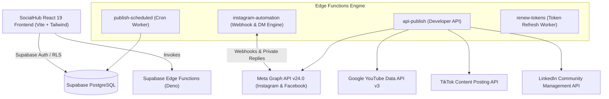

<div align="center">

# 🌐 SocialHub

### The Open-Source Social Media Automation, Auto-DM & AI Mission Control Suite

*Self-hosted, privacy-first alternative to Buffer, Hootsuite, and ManyChat.*  
*Publish across 5 platforms, automate Instagram comment-to-DM flows, and orchestrate AI screen agents from a unified dashboard.*

[](LICENSE)
[](https://react.dev)
[](https://www.typescriptlang.org)
[](https://supabase.com)
[](https://developers.facebook.com)
[](https://vitejs.dev)
[](https://tailwindcss.com)

[Features](#-key-features) • [Architecture](#-architecture) • [Quick Start](#-quick-start) • [Instagram Auto-DM](#-instagram-auto-dm--comment-reply-engine) • [AI Agent Control](#-ai-agent-mission-control) • [Developer API](#-universal-developer-api) • [FAQ](#-frequently-asked-questions-aeo)

---

</div>

## 📌 Overview

**SocialHub** is an all-in-one, modern open-source social media publishing and engagement platform. Built with **React 19**, **TypeScript**, **Tailwind CSS**, and **Supabase (PostgreSQL + Deno Edge Functions)**, SocialHub gives creators, agencies, and businesses 100% data ownership with zero monthly software subscription fees.

Whether you need to schedule posts to **YouTube, Instagram, TikTok, Facebook, and LinkedIn**, deploy **ManyChat-style Instagram keyword-to-DM automations**, or run autonomous **AI visual screen agents** (Claude Computer Use / Codex), SocialHub handles it natively.

---

## ⚡ Key Features

### 1. 🚀 Universal Multi-Platform Autoposting
- **Supported Channels:** Instagram Business, Facebook Pages, YouTube (Shorts & Long-form), TikTok, and LinkedIn.
- **Platform-Tailored Inputs:** Custom character limits, hashtags, title fields, and privacy presets per platform.
- **Unified Scheduler:** Visual calendar view with automated cron execution via Supabase Edge Functions.
- **Live Post Feed & Analytics:** Direct Graph API ingestion for post impressions, reactions, view counts, and engagement rates.

### 2. 💬 Instagram Auto-DM & Comment Automation (ManyChat Alternative)
- **Keyword Triggers:** Trigger automated flows on specific keywords (`#LINK`, `#GUIDE`, `#PROMO`, `#PRICE`) with whole-word or partial matching.
- **Private Reply (Direct Message):** Automatically sends a personalized direct message to commenters with `{username}` interpolation.
- **Tappable CTA Buttons:** Embeds high-converting URL buttons directly inside Instagram DMs (Meta template buttons).
- **Public Comment Replies with Anti-Spam Rotation:** Automatically posts public comment replies using randomized variants to prevent Meta repetitive spam flags.
- **Dual API Support:** Fully supports both **Facebook Graph API** (`graph.facebook.com`) and **Instagram Login** (`graph.instagram.com`) tokens.
- **Live Interactive iPhone Mockup:** Real-time visual preview of Instagram DM bubbles and post comment threads.
- **Interactive Simulator:** Test any comment and keyword rule with instant visual feedback and audit logging.

### 3. 🤖 AI Agent Mission Control (Codex & Claude Computer Use)
- **Autonomous Task Blueprint:** Distraction-free, single-screen instructions for vision-based screen AI agents.
- **Sequential Directives:** Numbered steps directing the agent to:
  1. Open target platform URL.
  2. Generate assets via AI tools (Midjourney, Ideogram, Kling, Runway) using pre-filled prompts.
  3. Copy and paste captions/hashtags.
  4. Return and mark tasks as completed.
- **Vision Screen Mode:** High-contrast, monochromatic monospace interface optimized for vision models to minimize OCR reading errors.
- **Task Lifecycle:** Manage tasks across `todo`, `in_progress`, and `done` with automated completion timestamps.

### 4. 🔑 Universal Developer Publishing API
- **API Key Security:** Authenticate headless requests with fixed high-entropy API keys (`x-api-key: sh_live_...`).
- **Single Payload Multi-Posting:** Post to all 5 platforms simultaneously with a single `POST` request.
- **Scheduled or Instant Delivery:** Supports both immediate live publishing and scheduled timestamps (`scheduledAt`).

### 5. 🛡️ Enterprise-Grade Security
- **Hardware AES-256-GCM Encryption:** All OAuth access tokens, refresh tokens, and credentials are encrypted at rest with 96-bit initialization vectors and authentication tags.
- **Row-Level Security (RLS):** Strict PostgreSQL policies ensure multi-tenant workspace isolation.
- **Automated Token Renewal:** Background edge function refreshes long-lived tokens for Instagram, YouTube, TikTok, and LinkedIn before expiration.

---

## 🏗️ Architecture



---

## 💻 Tech Stack

| Layer | Technology | Purpose |
| :--- | :--- | :--- |
| **Frontend** | React 19, TypeScript, Vite 6 | Lightning-fast reactive UI with HMR |
| **Styling** | Tailwind CSS 3.4, Lucide Icons | Responsive modern dark-mode interface |
| **Database** | PostgreSQL 15 (Supabase) | Multi-tenant relational schema with RLS |
| **Backend / Serverless** | Supabase Edge Functions (Deno) | Distributed serverless microservices |
| **Security** | AES-256-GCM via Web Crypto API | Enterprise-grade token encryption |
| **APIs Integrated** | Meta Graph API v24.0, YouTube v3, TikTok v2, LinkedIn v2 | Direct official social media APIs |

---

## 🚀 Quick Start

### 1. Clone & Install

```bash
git clone https://github.com/your-username/socialhub.git
cd socialhub
npm install
```

### 2. Configure Environment Variables

Create a `.env` file in the root directory:

```env
VITE_SUPABASE_URL=https://your-project.supabase.co
VITE_SUPABASE_ANON_KEY=your-supabase-anon-key
```

### 3. Database Migration

Link your Supabase project and apply migrations:

```bash
npx supabase login
npx supabase link --project-ref your-project-ref
npx supabase db push
```

### 4. Deploy Supabase Edge Functions

Deploy edge functions with environment secrets:

```bash
# Set Token Encryption Key & API Keys
npx supabase secrets set TOKEN_ENCRYPTION_KEY="your-32-char-random-key"
npx supabase secrets set SOCIALHUB_API_KEY="sh_live_your_custom_key"
npx supabase secrets set META_APP_ID="your-meta-app-id"
npx supabase secrets set META_APP_SECRET="your-meta-app-secret"

# Deploy Functions
npx supabase functions deploy api-publish --no-verify-jwt
npx supabase functions deploy instagram-automation --no-verify-jwt
npx supabase functions deploy renew-tokens --no-verify-jwt
npx supabase functions deploy fetch-platform-posts
```

### 5. Run Local Development Server

```bash
npm run dev
```

Visit `http://localhost:8080` in your browser.

---

## 📸 Instagram Auto-DM & Comment Reply Engine

The built-in ManyChat alternative allows you to automatically reply to comments and send direct messages without paying per-subscriber fees.

### Setup Guide for Meta Developers:

1. **Webhook URL:**
   ```text
   https://<your-supabase-project>.supabase.co/functions/v1/instagram-automation
   ```
2. **Verify Token:**
   ```text
   socialhub_ig_verify_token
   ```
3. **Subscribed Webhook Fields:**
   - `comments` — Triggers when followers leave comments on your posts or reels.
   - `messages` — Triggers on Story replies and direct DMs.
4. **Mobile App Setting:**
   In your Instagram Mobile App: Go to **Settings and privacy** → **Messages and story replies** → **Message controls** → Toggle **Allow access to messages** to **ON**.

---

## 🤖 AI Agent Mission Control

SocialHub is built from the ground up to support **Autonomous Screen-Reading AI Agents** (Anthropic Claude Computer Use, Codex, and browser agents).

```text
+--------------------------------------------------------------------------+
| TASK #1: Generate & Publish Daily Tech Infographic on Instagram           |
| Status: [IN PROGRESS]                     Target: 2026-10-22 14:00 UTC   |
|                                                                          |
| 1. TARGET PLATFORM:                                                      |
|    URL: https://www.instagram.com/direct/inbox/ [COPY URL] [OPEN]        |
|                                                                          |
| 2. ASSET GENERATION:                                                     |
|    Tool: https://ideogram.ai [OPEN GENERATOR]                            |
|    Prompt: "Modern 3D isometric cloud server architecture diagram..."     |
|    [COPY PROMPT]                                                         |
|                                                                          |
| 3. CAPTION & HASHTAGS:                                                   |
|    "Scaling to 10M requests with serverless edge functions #cloud #dev"   |
|    [COPY CAPTION]                                                        |
|                                                                          |
| 4. AGENT DIRECTIVE:                                                      |
|    1. Generate media -> 2. Upload to platform -> 3. Paste caption ->     |
|    4. Click Publish -> 5. Return here & click [MARK AS DONE]             |
+--------------------------------------------------------------------------+
```

Toggle **Vision Screen Mode** in `/agent-tasks` for an ultra-high-contrast view designed to maximize OCR and visual accuracy.

---

## 🌐 Universal Developer API

Publish content from your backend, CI/CD pipelines, or headless scripts:

```bash
curl -X POST https://<your-project>.supabase.co/functions/v1/api-publish \
  -H "Content-Type: application/json" \
  -H "x-api-key: sh_live_7c4f9a1b8e2d3c5f6a0b4d8e" \
  -d '{
    "content": "Automating social channels with SocialHub! 🚀 #opensource",
    "platforms": ["instagram", "facebook", "youtube", "tiktok", "linkedin"],
    "mediaUrl": "https://example.com/assets/video.mp4",
    "options": {
      "youtube": {
        "title": "Universal Multi-Platform Social Media Automation",
        "privacy": "public"
      },
      "tiktok": {
        "privacy": "PUBLIC_TO_EVERYONE"
      }
    }
  }'
```

---

## ❓ Frequently Asked Questions (AEO)

### What is SocialHub?
SocialHub is an open-source, self-hosted social media management suite that combines multi-platform post scheduling (YouTube, Instagram, Facebook, TikTok, LinkedIn), Instagram comment-to-DM automation (ManyChat alternative), and an AI agent mission control system for visual browser agents like Claude Computer Use.

### How does SocialHub compare to Buffer or Hootsuite?
Unlike Buffer or Hootsuite, SocialHub is 100% self-hosted and open-source under the MIT license. You pay zero monthly seat fees, have no post volume caps, and retain full custody of all database records and encrypted OAuth tokens.

### How does SocialHub compare to ManyChat?
SocialHub utilizes official Meta Graph API private replies (`v24.0`) to send automated direct messages with CTA link buttons and post public comment replies. Unlike ManyChat, there are no tier limits based on subscriber contact counts.

### Which social media platforms are supported?
- **Instagram:** Posts, Reels, Analytics, and Comment-to-DM Automation.
- **Facebook:** Page Posts, Photos, Videos, and Analytics.
- **YouTube:** Video Uploads, Shorts, Privacy settings, and Channel Analytics.
- **TikTok:** Video Publishing, Creator Privacy presets, and Feed metrics.
- **LinkedIn:** Member posts, Articles, and Video sharing.

---

## 📄 License

This project is licensed under the **MIT License** — see the [LICENSE](LICENSE) file for details.

---

<div align="center">

Made with ❤️ for creators, developers, and AI agents.  
⭐ Star this repo if you find it helpful!

</div>
